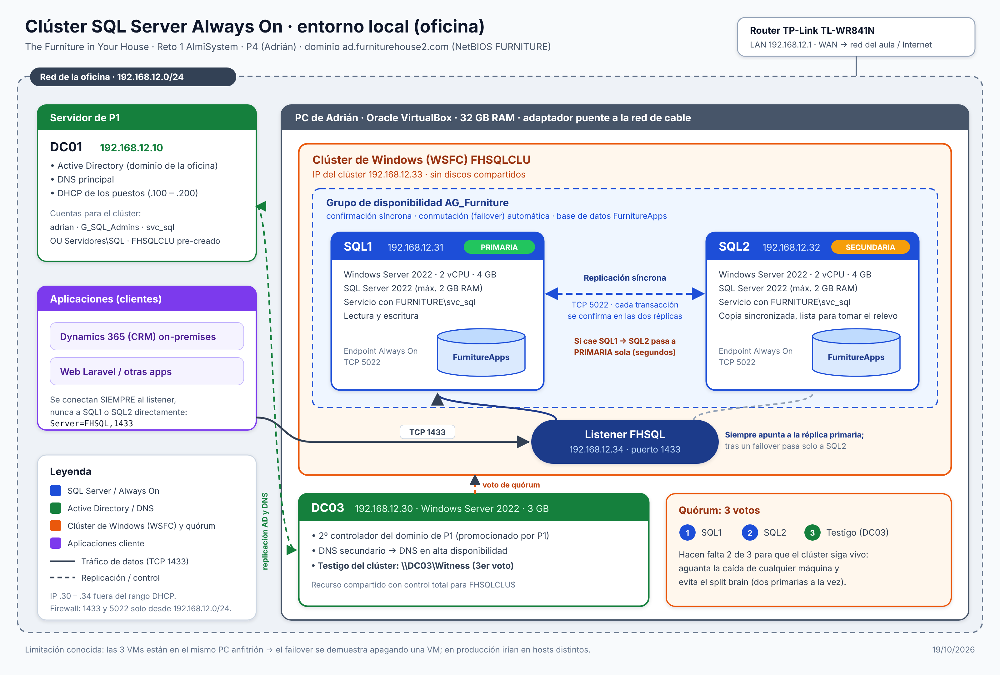

# Reto 1 · AlmiSystem — The Furniture in Your House

Repositorio del equipo de 2º ASIR (Almi, curso 2026-2027). Aquí está **todo el código, scripts y documentación** de la infraestructura de la empresa ficticia *The Furniture in Your House*.

> 🔒 **Nunca subas contraseñas, claves ni ficheros `.env`.** Lee [CONTRIBUTING.md](CONTRIBUTING.md) antes de tu primer cambio.

## Arquitectura

| Entorno | Qué hay | Responsable |
|---|---|---|
| **Local (oficina)** · red `192.168.12.0/24` · dominio `ad.furniturehouse2.com` | AD DS, DNS, DHCP (DC01/DC02/DC03), servidores de la oficina, servidor de Laravel | P1 |
| | Dynamics 365 (CRM), impresora, TPV y puestos | P2 |
| | **Clúster SQL Server Always On** (`FHSQLCLU`, AG `AG_Furniture`, listener `FHSQL`) | P4 |
| | Web **Laravel** (app, login con AD, servidor, base de datos) | P1 · P2 · P3 · P4 |
| **Nube (AWS)** | WordPress / tienda online + clúster MySQL, desplegado con Terraform | P3 (contenido) · P4 (plataforma) |



## Estructura del repositorio

```
.
├── .github/              # GitHub Actions (CI), plantillas de PR e issues
├── docs/                 # Documentación común y diagramas
├── laravel/              # Aplicación web Laravel (P3 app · P2 login AD · P1 servidor · P4 BD)
├── p1-sistemas/          # P1 · AD, DNS, DHCP, GPO, servidores de la oficina
├── p2-dynamics/          # P2 · Dynamics 365, impresora, TPV, puestos
├── p3-web/               # P3 · WordPress / tienda online
└── p4-aws-cluster/       # P4 · Terraform de AWS y scripts del clúster SQL Server
```

## Reparto de la antigua parte 5 (GitHub + Laravel)

| Persona | Bloque |
|---|---|
| P1 | Servidor de Laravel: Ubuntu + Nginx + PHP-FPM, HTTPS, DNS `laravel.ad.furniturehouse2.com` |
| P2 | Login de Laravel con usuarios del AD (LDAP), roles, pruebas y manual de usuario |
| P3 | Aplicación Laravel (CRUD de catálogo / pedidos) |
| P4 | Este repositorio, Kanban, GitHub Actions y la base de datos de Laravel en el clúster (`FHSQL`) |

## Integración continua

Cada *push* y cada *pull request* lanza [`.github/workflows/ci.yml`](.github/workflows/ci.yml):

- 🔎 **Secretos**: Gitleaks busca contraseñas o claves subidas por error.
- 🏗️ **Terraform**: `fmt` y `validate` de `p4-aws-cluster/terraform`.
- 🐘 **Laravel**: instala dependencias y ejecuta los tests (cuando exista `laravel/composer.json`).
- 💻 **PowerShell**: PSScriptAnalyzer revisa los scripts `.ps1`.

`main` está protegida: solo se cambia mediante *pull request* con la CI en verde.
